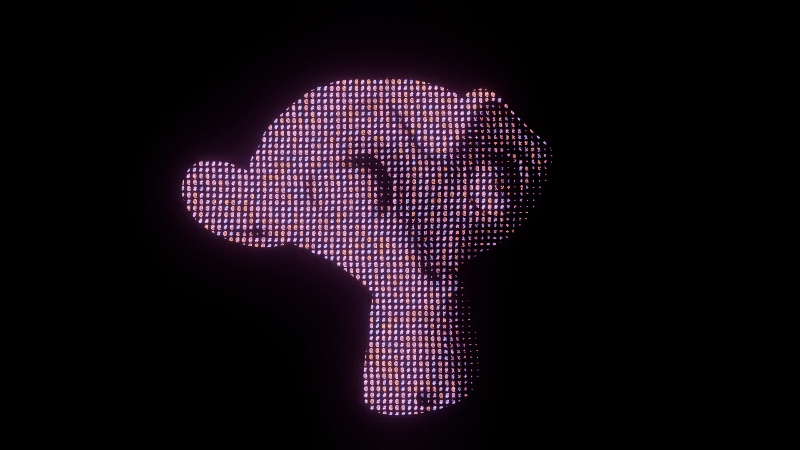

# ASCII Shader for Blender (EEVEE)

A screen-space ASCII art material for **3D objects** in Blender. Instead of post-processing the whole frame, it lives on the material, so you can put it on any object, light it, and animate it.

## Features

- Picks characters by brightness, so the lighting itself draws the shape
- Custom character set, with my own letters hidden in the glyph atlas
- Per-character color variation for a painterly look
- Shuffled glyphs and wavy, fabric-like rows (animatable with 4D noise)
- Glowing emission. Pair it with Bloom in the Compositor

## Requirements

- Blender 4.2 or newer (made in 5.x)
- **EEVEE only**. It uses the *Shader to RGB* node, which Cycles does not support.

## Installation

1. Download or clone this repository.
2. In Blender: **Edit → Preferences → Asset Libraries → +** and select the folder.
3. Set the Import Method to **Append**.
4. Open the **Asset Browser**, pick the library, and drag the `ASCII_vickussya` node group into the Shader Editor.
5. Connect the group's **Shader** output to **Material Output → Surface**.

## Tips

- **Grid size:** the Multiply node values (for example 128 × 72) set how many characters fit across the screen. Keep the ratio at 16:9.
- **Lighting matters:** characters appear only where there is light. Use a key light plus a rim light so silhouettes and motion read clearly.
- **Multi-material objects:** use *View Layer Properties → Override → Material* to apply the ASCII material to the whole scene at render time without changing your objects.
- **Glow:** in the Compositor, add a *Glare* node set to *Bloom*.

## Files

| File | Description |
|---|---|
| `ascii_shader.blend` | The node group asset, with the atlas packed inside |
| `ascii_atlas_vickusya_19.png` | Glyph atlas: 19 characters sorted dark → bright |

## License

MIT. Free to use in personal and commercial projects. Credit is appreciated!

---

